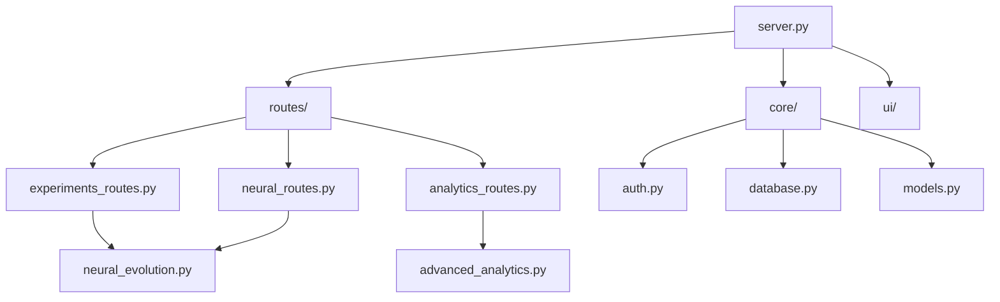

# 📁 Project Structure Documentation

## 🏗️ Genetic Coil Arena - Folder Organization

This document describes the complete folder structure and organization of the Genetic Coil Arena platform.

```
genetic-coil-arena/                 # 🏠 Project root
├── 📁 .git/                       # Git version control
├── 📁 .github/                    # GitHub workflows and templates
├── 📁 .vscode/                    # VS Code configuration
├── 📁 archive/                    # 📦 Legacy files and old versions
│   ├── demo*.py                   # Old demo scripts
│   ├── PHASE*.md                  # Phase completion reports
│   └── test_*.py                  # Legacy test files
├── 📁 data/                       # 💾 Application data
│   ├── experiments/               # Experiment results and configs
│   ├── models/                    # Trained AI/ML models
│   ├── cache/                     # Temporary cache files
│   └── exports/                   # Exported data and reports
├── 📁 storage/                    # 🗄️ Runtime storage
│   ├── uploads/                   # User uploaded files
│   ├── temp/                      # Temporary processing files
│   ├── backups/                   # Automatic backups
│   └── static/                    # Web static files
├── 📁 src/                        # 💻 Source code
│   └── 📁 genetic_coil_arena/     # Main package
│       ├── 📁 analysis/           # Data analysis modules
│       ├── 📁 cli/                # Command-line interface
│       ├── 📁 evo/                # Evolution algorithms
│       ├── 📁 persistence/        # Data persistence
│       ├── 📁 snake_core/         # Snake game environment
│       ├── 📁 ui/                 # User interface components
│       ├── 📁 web/                # Web API and server
│       │   ├── 📁 core/           # Core infrastructure
│       │   │   ├── auth.py        # Authentication system
│       │   │   ├── database.py    # Database management
│       │   │   ├── file_storage.py # File handling
│       │   │   └── models.py      # Data models
│       │   ├── 📁 routes/         # API route definitions
│       │   │   ├── experiments_routes.py    # Core experiments
│       │   │   ├── neural_routes.py         # Neural evolution
│       │   │   ├── analytics_routes.py      # Analytics & AI
│       │   │   ├── auth_routes.py           # Authentication
│       │   │   ├── team_management_routes.py # Team features
│       │   │   ├── performance_routes.py     # Performance monitoring
│       │   │   ├── mobile_routes.py          # Mobile APIs
│       │   │   ├── visualization_3d_routes.py # 3D visualization
│       │   │   ├── batch_routes.py           # Batch processing
│       │   │   ├── notifications_routes.py   # Notifications
│       │   │   ├── templates_routes.py       # Templates
│       │   │   ├── comparison_routes.py      # Comparisons
│       │   │   ├── scheduling_routes.py      # Scheduling
│       │   │   └── version_control_routes.py # Version control
│       │   ├── 📁 ui/             # UI components and routers
│       │   │   ├── batch_ui.py              # Batch UI
│       │   │   ├── team_management_ui.py    # Team UI
│       │   │   ├── templates_ui.py          # Templates UI
│       │   │   ├── visualization_3d_ui.py   # 3D UI
│       │   │   └── *_ui_router.py          # UI routers
│       │   ├── 📁 static/         # Static web assets
│       │   ├── server.py          # Main server application
│       │   ├── advanced_analytics.py # Advanced ML analytics
│       │   ├── analytics.py       # Basic analytics
│       │   ├── batch.py          # Batch processing logic
│       │   ├── comparison.py     # Experiment comparison
│       │   ├── deployment.py     # Deployment utilities
│       │   ├── file_storage.py   # File storage system
│       │   ├── notifications.py  # Notification system
│       │   ├── performance_optimizer.py # Performance optimization
│       │   ├── scalability.py    # Scalability management
│       │   ├── scheduling.py     # Task scheduling
│       │   ├── team_management.py # Team collaboration
│       │   ├── templates.py      # Template system
│       │   ├── version_control.py # Version control
│       │   ├── visualization.py  # Basic visualization
│       │   └── visualization_3d.py # 3D visualization
│       ├── advanced_visualization.py # Advanced viz components
│       ├── config.py             # Configuration management
│       ├── neural_evolution.py   # Neural evolution core
│       ├── neuro_evolution_engine.py # PyTorch engine
│       ├── __init__.py           # Package initialization
│       └── __main__.py           # Main entry point
├── 📁 tests/                     # 🧪 Test suite
│   ├── test_agent.py             # Agent tests
│   ├── test_integration.py       # Integration tests
│   ├── test_simple_integration.py # Simple integration tests
│   ├── test_snake_game.py        # Game tests
│   └── temp/                     # Test temporary files
├── 🚀 start_server.py            # Server launcher script
├── 🎯 comprehensive_demo.py      # Complete feature demo
├── 🧪 test_integration.py        # Main integration tests
├── 🎮 test_viewer.py             # Game viewer test
├── 📚 README.md                  # Main documentation
├── 📋 PRODUCTION_READY_SUMMARY.md # Production status
├── 📄 CONTRIBUTING.md            # Contribution guidelines
├── ⚖️ LICENSE                    # MIT license
├── ⚙️ pyproject.toml             # Python project configuration
├── 🔧 .gitignore                 # Git ignore rules
└── 📋 PROJECT_STRUCTURE.md       # This file
```

## 📋 Directory Descriptions

### 🏠 Root Level
- **archive/** - Contains legacy files, old demos, and phase reports
- **data/** - Application data including experiments and models
- **storage/** - Runtime storage for uploads, temp files, and backups
- **src/** - Main source code directory
- **tests/** - Comprehensive test suite

### 💻 Source Code (`src/genetic_coil_arena/`)

#### 🌐 Web Module (`web/`)
**Organized into three main subdirectories:**

1. **core/** - Infrastructure components
   - Authentication and authorization
   - Database management
   - File storage
   - Data models and schemas

2. **routes/** - API endpoint definitions
   - All API routes organized by feature
   - RESTful endpoint implementations
   - Request/response handling

3. **ui/** - User interface components
   - Web UI routers
   - Interface components
   - Frontend integration

#### 🧠 Core Modules
- **neural_evolution.py** - Neural evolution algorithms
- **neuro_evolution_engine.py** - PyTorch integration
- **snake_core/** - Game environment implementation
- **analysis/** - Data analysis and reporting
- **evo/** - Genetic algorithm implementations
- **persistence/** - Data persistence layer
- **ui/** - User interface components
- **cli/** - Command-line interface

## 🔗 Module Dependencies



## 🎯 Key Files

### 🚀 Entry Points
- **start_server.py** - Simple server launcher
- **src/genetic_coil_arena/__main__.py** - Package entry point
- **src/genetic_coil_arena/web/server.py** - Main server application

### 📖 Documentation
- **README.md** - Main project documentation
- **PRODUCTION_READY_SUMMARY.md** - Production status
- **PROJECT_STRUCTURE.md** - This file
- **CONTRIBUTING.md** - Contribution guidelines

### 🧪 Testing
- **test_integration.py** - Comprehensive integration tests
- **comprehensive_demo.py** - Feature demonstration
- **test_viewer.py** - Game viewer testing

### ⚙️ Configuration
- **pyproject.toml** - Python project configuration
- **.gitignore** - Git ignore rules
- **LICENSE** - MIT license

## 🔄 Data Flow

1. **Requests** come into `server.py`
2. **Routing** handled by modules in `routes/`
3. **Authentication** processed by `core/auth.py`
4. **Business logic** executed in feature modules
5. **Data persistence** managed by `core/database.py`
6. **File operations** handled by `core/file_storage.py`
7. **Responses** formatted using `core/models.py`

## 🛠️ Development Workflow

1. **Feature development** happens in respective modules
2. **API endpoints** added to appropriate route files
3. **Data models** defined in `core/models.py`
4. **Tests** added to `tests/` directory
5. **Integration tests** verify end-to-end functionality

## 📦 Deployment Structure

For production deployment:
- **src/** contains the application code
- **data/** persists application data
- **storage/** handles runtime files
- **archive/** excluded from deployment

This organization ensures:
- ✅ **Clear separation of concerns**
- ✅ **Easy maintenance and updates**
- ✅ **Scalable architecture**
- ✅ **Production-ready structure**
- ✅ **Comprehensive documentation**
